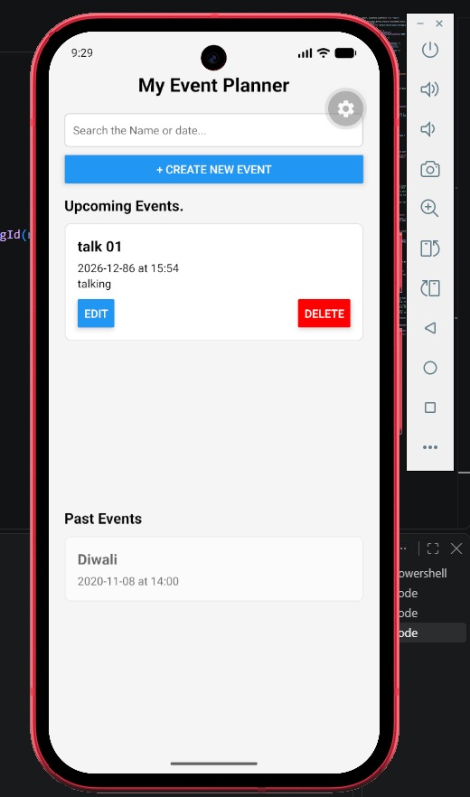
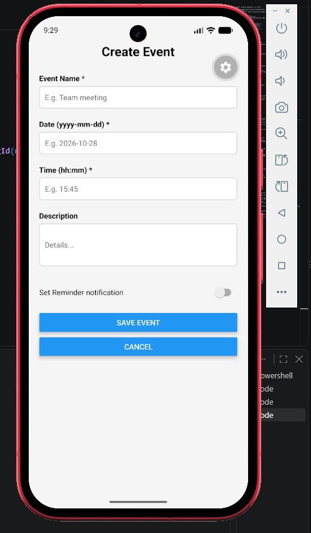
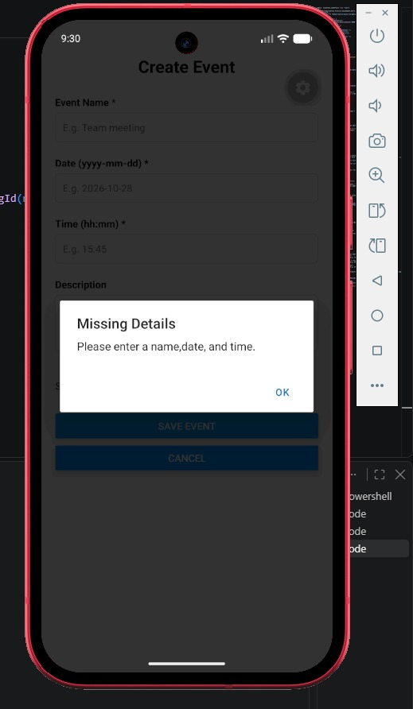
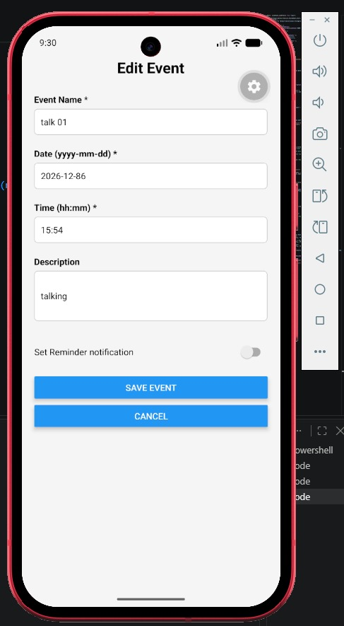
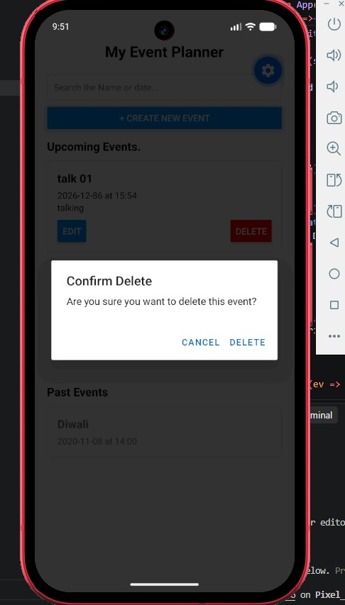
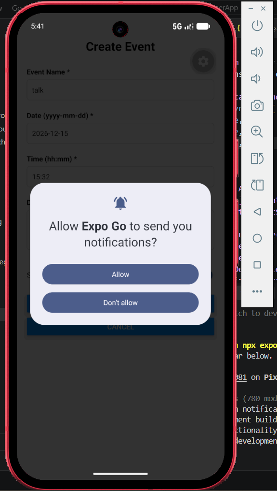

# Event Planner App

**Student Name:** THEEKSHANA ISURU BANDARA
**Index Number:** JF/ICT/25/11  
**Module:** Developing Mobile App (K72T001M15) - NVQ Level 05 Semester - 2  

## 📱 App Description
The Event Planner App is a mobile application built using React Native and Expo. It allows users to create, organize, and manage their daily events and tasks. Users can add new events with a specific date, time, and description, view upcoming and past events separately, search for events, and easily edit or delete them.

## ✨ Features Implemented
*   **Create Event:** Add new events with Name, Date (YYYY-MM-DD), Time (HH:MM), and Description. Includes input validation.
*   **View Upcoming/Past Events:** Events are automatically sorted and categorized based on the current date/time.
*   **Edit / Delete:** Users can modify existing events or delete them with a confirmation alert.
*   **Search:** Users can search for events by name or date.
*   **Local Storage:** Uses AsyncStorage to save data locally so events persist after the app is closed.
*   **Reminders/Notifications:** Local notifications are scheduled using `expo-notifications` if the user enables the reminder switch.
*   **Empty States:** Displays friendly messages when lists are empty.

## 🛠️ Tools and Technologies Used
*   **Framework:** React Native
*   **Environment:** Expo, Node.js
*   **Language:** JavaScript (ES6)
*   **Storage:** @react-native-async-storage/async-storage
*   **Notifications:** expo-notifications

## 🚀 How to Run the App
1. Clone the repository: `git clone https://github.com/theekshana-glitch/EventPlannerApp_25ict11`
2. Navigate to the project folder: `cd EventPlannerApp-YourIndexNo`
3. Install dependencies: `npm install`
4. Start the Expo development server: `npx expo start`
5. Open the app on an Android Emulator (press `a` in the terminal) or scan the QR code using the Expo Go app.

## 📸 Screenshots

*(Note: Please ensure the images are placed correctly inside the `screenshots` folder).*

## 🧪 Documentation of Testing (Working Demo)
The application was thoroughly tested on an Android Emulator using Expo Go. The following test cases were executed:

1.  **Create Event & Validation:** Attempted to save an empty form; an alert appeared. Entered valid details; event saved and appeared in the list.
2.  **Upcoming vs. Past:** Created a future date event and a past date event. Both were correctly categorized.
3.  **Edit:** Changed the title and time of an existing event and saved it successfully.
4.  **Delete:** Clicked delete; a confirmation alert appeared, and the event was removed upon confirmation.
5.  **Search:** Typed an event name in the search bar; the list filtered in real-time.

### ⚠️ Note on Notifications
Local notifications were successfully implemented and tested (screenshot attached). Due to Expo Go's restrictions on background tasks (SDK 53+), notifications may not appear if the app is completely closed. The app successfully schedules the notification, which works perfectly in a development build.